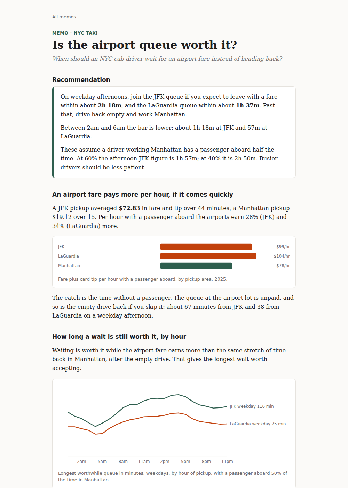

# case-studies

Short analytical memos on public data, each ending in a recommendation someone could act on.
Python, DuckDB, Jinja, inline SVG. Every figure is rebuilt from small committed snapshots.

**Read them: [m4dd0ck.github.io/case-studies](https://m4dd0ck.github.io/case-studies/)**



This file is the reference: what exists and how it works. `RUNBOOK.md` is the procedures,
`CLAUDE.md` the agent rules, `TASK.md` the open items.

## What it is

Two memos, each one question on one public dataset:

| Memo | Question | Answer (short) | Data |
|---|---|---|---|
| [Is the airport queue worth it?](https://m4dd0ck.github.io/case-studies/airport-queue.html) | When should an NYC cab driver wait for an airport fare instead of heading back? | Weekday afternoons: if the wait is under about 2h 18m at JFK and 1h 37m at LaGuardia. Much less at night. | TLC yellow-cab trips, 2025 (43.8M trips) |
| [Which card complaints to fix first](https://m4dd0ck.github.io/case-studies/card-complaints.html) | Which credit-card complaint issues are growing and costing issuers money? | Disputed statement purchases and fees/interest: 48% of complaints, 74% of those ending in money back. One apparent jump is likely a relabel. | CFPB complaint database, 2024-2026 |

Each memo follows the same shape: recommendation first, then the findings behind it, the
caveats (what the data cannot tell you), next steps, and the method in the footer.

## Why it exists

A dashboard shows numbers; a memo takes a position and says what the data cannot tell you.
These two exist to show that kind of work end to end on data anyone can check. The figures a
memo quotes are pinned by tests, so a changed snapshot or formula fails the build before it
quietly changes a recommendation.

## Quick start

Needs Python 3.12+ and [uv](https://github.com/astral-sh/uv).

```bash
uv sync
uv run memos site             # render site/ from the committed snapshots (no network)
uv run pytest
```

## Commands

All run as `uv run memos <command>`. The table is regenerated from `memos --help` by the doc
check; edit the help strings in `src/case_studies/cli.py`, not this table.

<!-- generated:commands start -->
<!-- do not hand-edit: regenerated by doc-check --fix -->
| Command | What it does |
|---|---|
| `memos extract-taxi` | Rebuild the taxi snapshot from TLC trip records (downloads ~700 MB). |
| `memos extract-cfpb` | Rebuild the complaint snapshots from the CFPB API. |
| `memos site` | Render the memos from the committed snapshots (no network). |
<!-- generated:commands end -->

`site --out DIR` picks the output folder (default `site/`); it refuses a non-empty folder it
did not build itself. The two extracts rewrite the snapshots in `data/` and need the network;
`extract-taxi` reads about 700 MB of TLC parquet.

## How it works

- **Airport queue.** Break-even wait `W = A / r - T + D`: the airport fare `A` over `T` minutes,
  against Manhattan earnings per minute `r` and the empty drive back `D`. Trip records do not
  show time without a passenger, so `r` is shown at 40%, 50% and 60% utilization rather than
  guessed at one value.
- **Card complaints.** Priority = complaints x the share historically closed with money back.
  Issue pairs where one's loss matches most of the other's gain, switching in the same month,
  are flagged as likely relabels and quoted together.

`tests/test_memos.py` pins every figure a memo quotes, so a change to a snapshot or formula
fails the tests before it changes a recommendation. The site renders from the committed
snapshots only; CI never downloads source data.

## Layout

```
data/                    # committed snapshots the memos are built from
src/case_studies/
├── taxi.py              # TLC extract + break-even wait
├── cfpb.py              # CFPB extract, growth, relief rates, relabel detection
├── charts.py            # inline SVG
├── memos/               # one module per memo: snapshot -> the facts it quotes
├── templates/           # one template per memo
├── site.py              # renders the memos + index
└── cli.py               # memos site | extract-taxi | extract-cfpb
tests/                   # pins for every quoted figure, extract logic, site output
assets/                  # the README screenshot
site/                    # rendered output; gitignored
```

## Outside the repo

| Thing | Where | Notes |
|---|---|---|
| Published site | GitHub Pages for this repo | deployed by CI on every push to `main` |
| NYC Taxi & Limousine Commission | [TLC Trip Record Data](https://www.nyc.gov/site/tlc/about/tlc-trip-record-data.page) | source of the taxi snapshot |
| Consumer Financial Protection Bureau | [Consumer Complaint Database](https://www.consumerfinance.gov/data-research/consumer-complaints/) | source of the complaint snapshots, via the public API |

## Development

```bash
uv run ruff check . && uv run ruff format --check . && uv run mypy src/
uv run pytest
```

CI runs the same checks, then renders the site and deploys it to Pages from `main`. Licensed
MIT (`LICENSE`).

## Pointers

- `RUNBOOK.md`: run, refresh a snapshot, release, deploy, restore.
- `CLAUDE.md`: the agent rules.
- `TASK.md`: what is open.
- `~/developer/hq/CONVENTIONS.md`: the portfolio release and commit rules.
